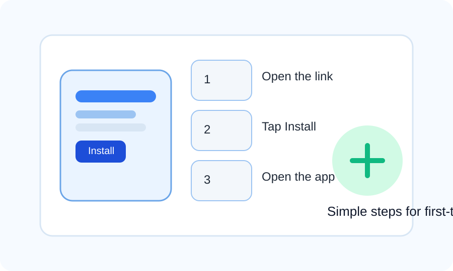

# eKolekta Mobile User Guide

Welcome! This guide will help you use the eKolekta Mobile app with easy, step-by-step instructions.

## 1. Install the app

Installing the app is quick and easy. Follow the steps below depending on whether the app is already on your device or needs to be downloaded.

### If the app is already installed

1. Open the app from your phone or tablet home screen.
2. If your device asks for permission to continue, tap Allow.
3. Wait a few seconds for the app to load.

### If you need to install it

1. Open the installation app or the link or QR code provided below:
   https://expo.dev/accounts/ekolekta-v2/projects/osp-ekolektav2-react-native/builds/55182a6c-591e-4b57-9256-e88ac594d4ef
2. Tap Install.
3. Click Download Anyway and wait for the file to finish downloading.
4. Locate the app and click Install, then wait for the installation to finish.
5. Once the installation is complete, open the app from your home screen.

A simple visual guide is shown below to help you understand the installation flow:

> If you do not see the install button, make sure your device is connected to the internet and that you are opening the link on a supported phone or tablet.

## 2. Sign in

When the app opens, you will see the login screen.

1. Enter your email address.
2. Enter your password.
3. Tap Sign In.

If you are using the demo version, you can try:

- Email: demo@stpeter.com.ph
- Password: password

> These are demo login details for testing only.

## 3. Move around the app

After you sign in, you will see the main dashboard.

Use the bottom menu to move between sections:

- Dashboard
- MCPR
- Payment
- View DRS
- Encode Deposit
- View Deposit
- Disbursement
- Planholder Profile
- Profile

You can also open the side menu from the top of the screen if it is available.

## 4. Use the main features

### Dashboard

1. Open the Dashboard screen.
2. Look at the summary cards for sales, accounts, and collections.
3. Use this screen to quickly see the current status.

### MCPR

1. Open the MCPR section.
2. Read the information shown.
3. Use any available actions or filters if displayed.

### Payment

1. Open the Payment screen.
2. Choose the planholder or payment entry you want to work on.
3. Enter the payment details required.
4. Check the amount shown.
5. Tap the button to save or submit the payment.

### View DRS

1. Open View DRS.
2. Use the search box to find a Digital Remittance Slip.
3. Tap the record you want to open.
4. Read the details and payment rows shown.

### Encode Deposit

1. Open Encode Deposit.
2. Search and select the correct DRS.
3. Enter the deposit date, account number, and amount.
4. Choose the bank branch if asked.
5. Tap Save to record the deposit.

### View Deposit

1. Open View Deposit.
2. Select a deposit from the list.
3. Review the details and current status.
4. Use the available options to update or delete the deposit if needed.

### Disbursement

1. Open the Disbursement section.
2. Review the list or record shown.
3. Select the item you want to inspect.
4. Follow the on-screen instructions.

### Planholder Profile

1. Open Planholder Profile.
2. Search for the planholder.
3. Review the profile and account information shown.

### Profile

1. Open Profile.
2. Review your account details.
3. Use the available options to manage your session.

## 5. Helpful tips

- Make sure your device has internet access when using online features.
- Use the search boxes to find records quickly.
- If the app stops responding, close it and open it again.
- If you are using the app in development mode, keep it connected to the development server.

## 6. Troubleshooting

If you cannot sign in or open the app:

- Check that your email and password are correct.
- Make sure your device is connected to the internet.
- Restart the app and try again.
- Contact your app administrator if the problem continues.

## 7. Support

If you need help, contact your app administrator or the development team.
